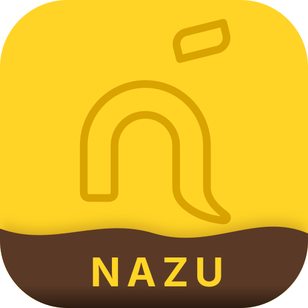

<h1 align="center">
  <br>
  Nazu
</h1>

<p align="center">
  
  
  <a href="LICENSE"></a>
  <a href="https://nazu.huniee.dev/docs"></a>
</p>

<p align="center">
  Nazu는 <a href="https://github.com/ye-seola/arisa2">Arisa</a> 기반의 카카오톡 봇을 만드는 Node.js 라이브러리입니다.<br>
  TypeScript 타입과 웹 대시보드를 함께 제공합니다.
</p>

## 시작하기

### 준비

- Node.js 22 이상 (24 이상 권장)
- 실행 중인 Arisa 서버: 설치 방법은 [환경 준비 문서](https://nazu.huniee.dev/docs)를 참고하세요.

### 설치

```sh
npm install @huni_ee/nazu
```

예제는 [사용 예시](https://nazu.huniee.dev/docs/examples)에서 볼 수 있습니다.

> 메서드와 타입은 [레퍼런스](https://nazu.huniee.dev/docs/reference)에서 확인할 수 있습니다.

## 샘플 봇

[arisa_bot](https://github.com/huni-ee/arisa_bot)은 Nazu로 만든 카카오톡 샘플 봇입니다.

## 대시보드

`client.start()`를 호출하면 대시보드도 함께 켜집니다. 브라우저에서 `http://127.0.0.1:3001`로 접속하세요. 이 컴퓨터에서만 접속할 수 있습니다.

```ts
new ArisaClient({ dashboardPort: 4000 }); // 포트 변경
new ArisaClient({ dashboard: false }); // 대시보드 끄기
```

## 개발

| 명령                     | 설명                                           |
| ------------------------ | ---------------------------------------------- |
| `npm install`            | 의존성 설치                                    |
| `npm run build`          | 라이브러리와 대시보드 빌드                     |
| `npm run check`          | lint, 타입 검사, 포맷 검사                     |
| `npm run proto:generate` | `proto/arisa.proto`를 바꾼 뒤 gRPC 코드 재생성 |

## 주의

Nazu는 Kakao Corp.가 만들거나 인가하지 않았으며, 언제든지 이용이 제한될 수 있습니다. 라이브러리 사용으로 생기는 책임과 불이익은 모두 사용자에게 있습니다.

## 라이선스

Nazu는 Apache License 2.0을 따릅니다.

전문은 [`LICENSE`](LICENSE)를 참고하세요. 대시보드에 포함한 외부 자료의 라이선스 원문은 [`licenses`](src/dashboard/web/public/licenses) 폴더에 있고, 출처는 해당 코드에 주석으로 적었습니다.

## 참고

코드는 Nazu용으로 따로 작성했으며, 아래 프로젝트를 참고했습니다.

- [Arisa](https://github.com/ye-seola/arisa2): 연결 대상 gRPC 서버
- [kakaolink-py](https://github.com/ye-seola/kakaolink-py), [kakaolink](https://github.com/naijun0403/kakaolink): 카카오링크
- [KiwiTalk](https://github.com/KiwiTalk/KiwiTalk), [Fuwari](https://github.com/saicaca/fuwari): 대시보드 화면
